# Hyderabad Traffic Analytics Pipeline on Azure

A **batch** data engineering pipeline, run on **synthetic** Hyderabad traffic data, built with **Azure Data Factory, ADLS Gen2 and Azure Databricks**, with a machine learning model that predicts congestion one hour ahead and gold tables ready for **Power BI**.

The architecture follows an IEEE 2025 conference paper, *"Modern Data Engineering: Integrating Databricks, Azure, and Power BI for Real-Time Analytics"*, rebuilt at a smaller scale on an Azure for Students subscription.

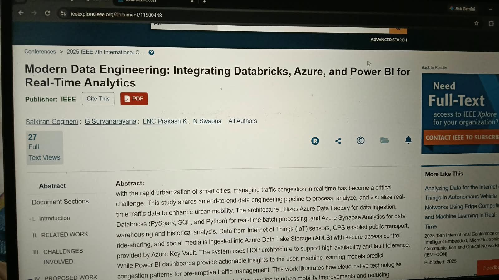

## The problem

Traffic congestion in Hyderabad, especially on the IT corridor (Hitech City, Gachibowli, Madhapur), builds up daily. Traffic data arrives from many sources in raw, messy form. A traffic team needs a pipeline that can ingest it, clean it, answer questions (which junctions, when, and how weather changes things), predict congestion before it happens, and produce tables ready for Power BI.

## The solution

A **medallion architecture** (bronze, silver, gold) on an Azure data lake, with Databricks for processing and ML.

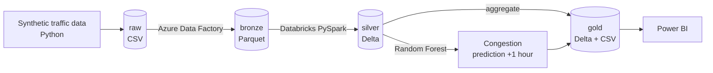

| Stage | Tool | What it does |
|---|---|---|
| Source data | Python (pandas, numpy) | 34,560 readings: 30 days x 96 readings a day x 12 junctions |
| Ingestion | Azure Data Factory | Copies the raw CSV to bronze as compressed Parquet |
| Storage | ADLS Gen2 | Four containers: raw, bronze, silver, gold |
| Processing | Azure Databricks (serverless, PySpark) | Cleans data into silver (Delta) and builds four gold tables |
| Access control | Access Connector + managed identity | Databricks reads storage without keys or secrets |
| Machine learning | scikit-learn Random Forest | Predicts congestion level one hour ahead |
| Visualisation | Power BI Desktop | Loads the gold tables |

## Dataset

Synthetic, because real city traffic feeds are not public. It is designed to behave like real traffic: morning and evening rush hours, quieter weekends, busier IT-corridor junctions, rain increasing traffic load by 25%, and about 1% of speed values left blank so the cleaning step has real work to do.

| Column | Meaning |
|---|---|
| `timestamp` | 15-minute readings, 1 to 30 October 2026 |
| `junction`, `latitude`, `longitude` | One of 12 Hyderabad junctions |
| `is_weekend`, `weather` | 1 for Saturday or Sunday; Clear or Rain |
| `vehicle_count`, `avg_speed_kmph` | Vehicles per 15 minutes; average speed (some missing) |
| `congestion_level` | Low (30 km/h or more), Medium (15 to 30), High (under 15) |

Generate it with `python src/generate_traffic_data.py`.

## Pipeline in pictures

**1. Ingestion with Azure Data Factory (raw to bronze)**

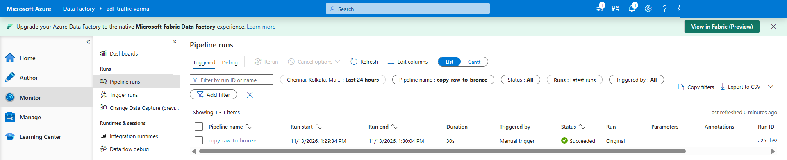

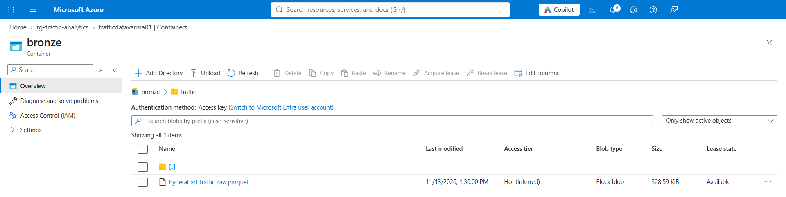

**2. Secure storage access from Databricks (managed identity, no keys)**

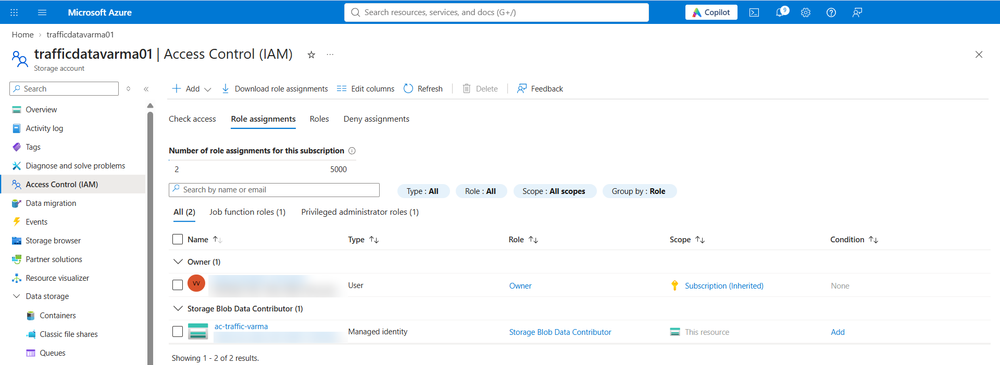

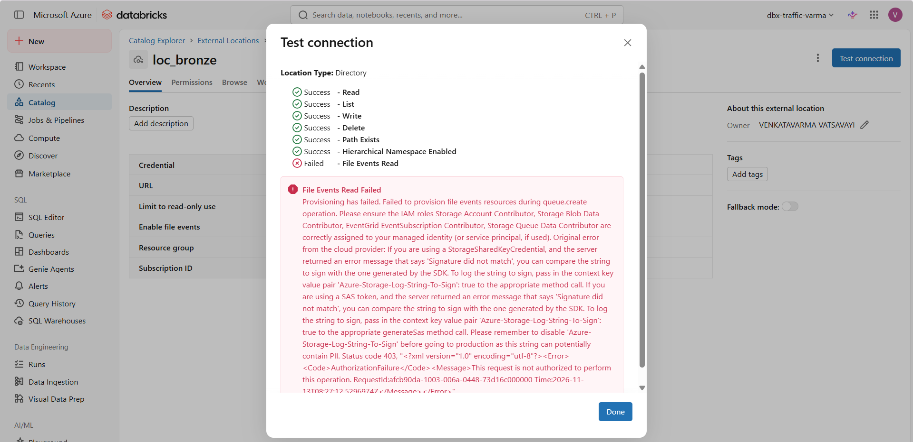

**3. Bronze, silver and gold in Databricks**

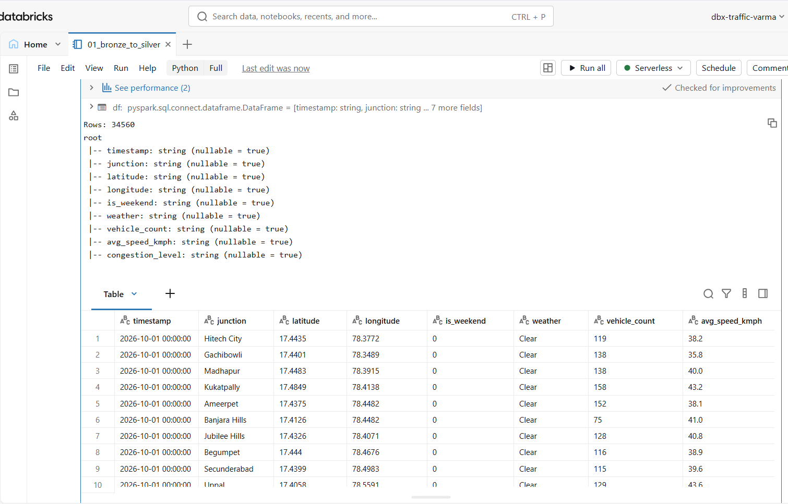

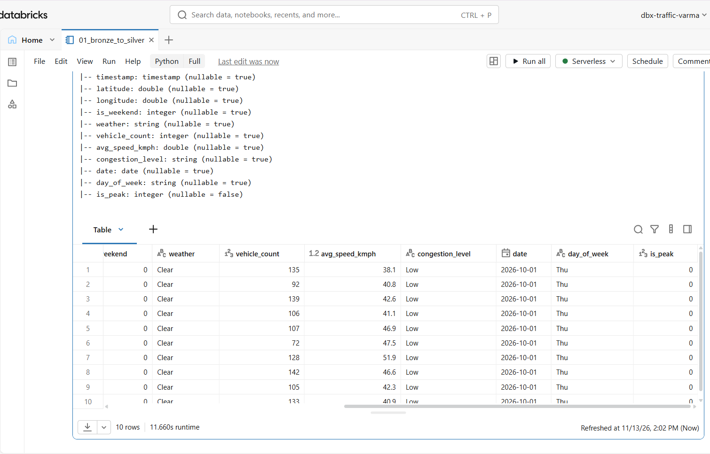

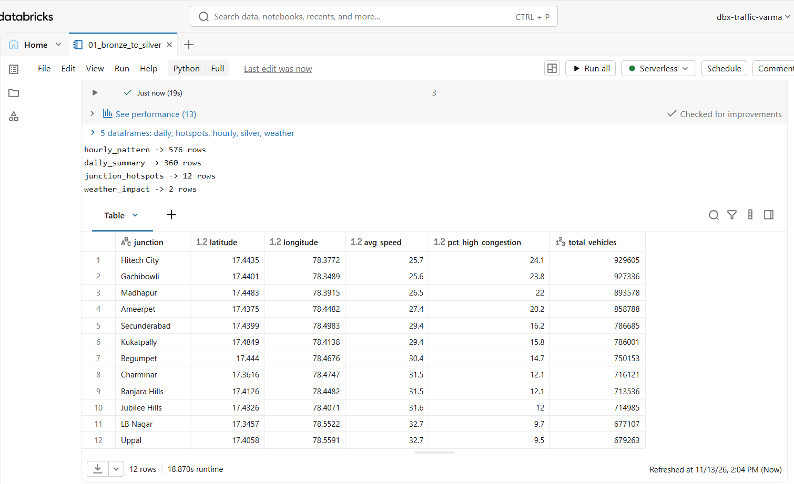

## Results

### Gold tables

| Table | Rows | Answers |
|---|---|---|
| `hourly_pattern` | 576 | When is each junction busiest, weekday vs weekend? |
| `daily_summary` | 360 | How does each junction trend day by day and with weather? |
| `junction_hotspots` | 12 | Which junctions are the worst? |
| `weather_impact` | 2 | How much does rain change speed and congestion? |

### Junction hotspot ranking

| Junction | Avg speed (km/h) | High congestion (%) | Total vehicles |
|---|---|---|---|
| Hitech City | 25.7 | 24.1 | 929,605 |
| Gachibowli | 25.6 | 23.8 | 927,336 |
| Madhapur | 26.5 | 22.0 | 893,578 |
| Ameerpet | 27.4 | 20.2 | 858,788 |
| Secunderabad | 29.4 | 16.2 | 786,685 |
| Kukatpally | 29.4 | 15.8 | 786,001 |
| Begumpet | 30.4 | 14.7 | 750,153 |
| Charminar | 31.5 | 12.1 | 716,121 |
| Banjara Hills | 31.5 | 12.1 | 713,536 |
| Jubilee Hills | 31.6 | 12.0 | 714,985 |
| LB Nagar | 32.7 | 9.7 | 677,107 |
| Uppal | 32.7 | 9.5 | 679,263 |

The IT-corridor junctions rank highest, which is the pattern built into the data.

### Congestion prediction (1 hour ahead)

The model predicts the congestion level **one hour (four readings) ahead**. The target is the future level, not the current one, to avoid data leakage. Training uses 1 to 24 October and testing uses 25 to 30 October (a time-based split, no shuffling).

| Measure | Accuracy |
|---|---|
| Baseline ("next hour = current level") | **69.5%** |
| Random Forest | **88.6%** |

| Class | Precision | Recall | F1 | Test rows |
|---|---|---|---|---|
| High | 0.90 | 0.91 | 0.91 | 1,277 |
| Low | 0.91 | 0.95 | 0.93 | 4,007 |
| Medium | 0.79 | 0.70 | 0.74 | 1,580 |

Medium is the hardest class because it sits between Low and High. The top features are vehicle count, average speed and hour of day.

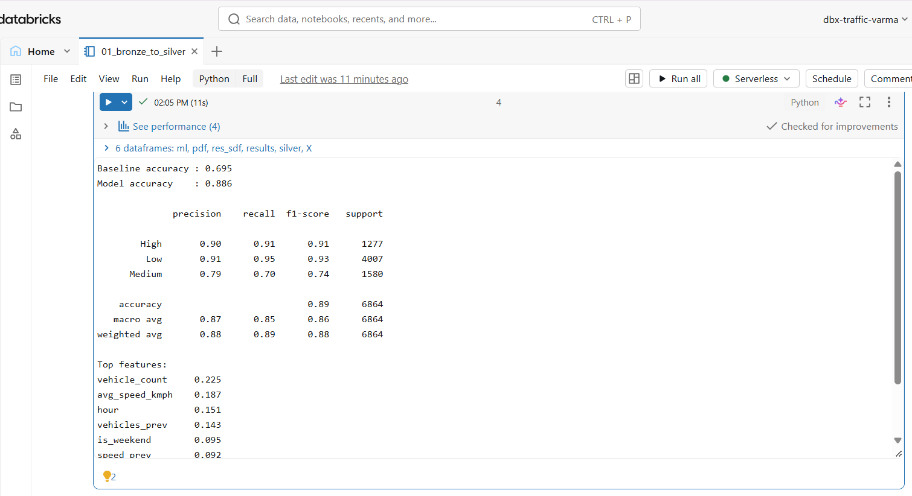

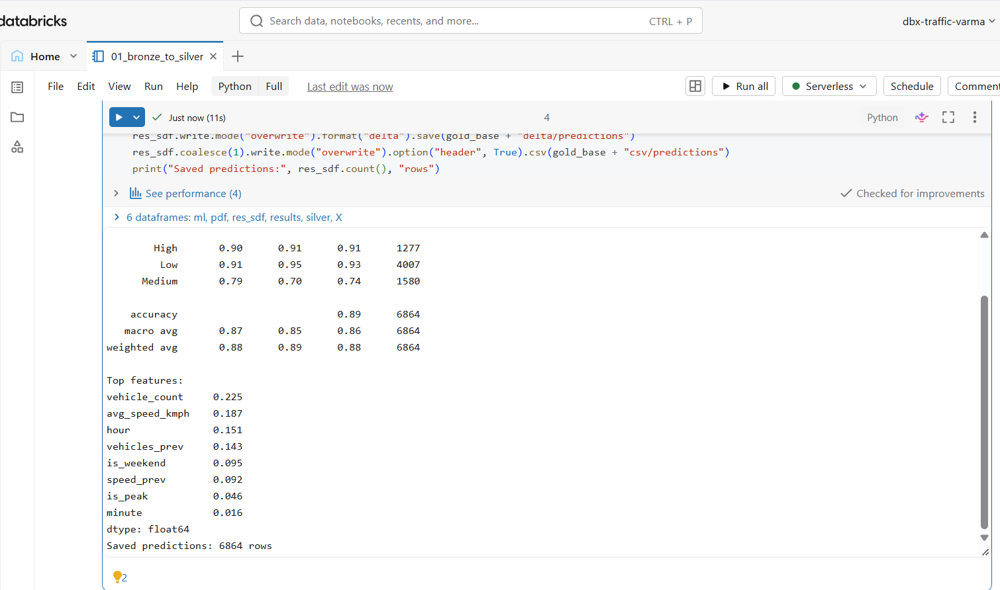

## Power BI

The five gold CSV files (`hourly_pattern`, `daily_summary`, `junction_hotspots`, `weather_impact`, `predictions`) are produced for loading into Power BI Desktop. The dashboard itself is not part of this repository yet.

## Repository structure

```
.
├── README.md
├── src/generate_traffic_data.py          # synthetic data generator
├── notebooks/01_traffic_pipeline.ipynb   # Databricks: bronze -> silver -> gold -> model
├── docs/Azure_Traffic_Analytics_Step_by_Step_Guide.docx   # full guide with screenshots
├── images/                               # screenshots used in the guide and README
├── requirements.txt
└── LICENSE
```

## How to reproduce

The complete walkthrough with every screenshot is in [`docs/Azure_Traffic_Analytics_Step_by_Step_Guide.docx`](docs/Azure_Traffic_Analytics_Step_by_Step_Guide.docx). In short:

1. Create a resource group and an ADLS Gen2 storage account (hierarchical namespace on) with containers `raw`, `bronze`, `silver`, `gold`.
2. Run `src/generate_traffic_data.py` and upload the CSV to `raw`.
3. In Azure Data Factory, copy `raw` to `bronze/traffic` as Parquet.
4. Create a Databricks workspace (serverless), an Access Connector with *Storage Blob Data Contributor* on the storage account, a storage credential, and external locations for bronze, silver and gold.
5. Import `notebooks/01_traffic_pipeline.ipynb` into Databricks and run the cells. Replace `trafficdatavarma01` with your storage account name.
6. Download the gold CSVs and load them into Power BI Desktop.

## Limitations

- The data is **synthetic**, so results reflect the patterns built into the generator, not real Hyderabad traffic.
- The pipeline is **batch**. The paper describes real-time processing, which would need streaming ingestion.
- Synapse Analytics and Key Vault from the paper were left out to save credits. Managed identity handles secure storage access instead.

## Next steps

- Replace synthetic data with a real traffic dataset plus real weather from the Open-Meteo API.
- **Real-time monitoring:** count vehicles from camera or video footage with a YOLO model, stream the counts through Azure Event Hubs, and process them in Databricks.
- Track model experiments with MLflow and add anomaly detection for unusual jams.
- Schedule the Data Factory pipeline and the notebook, and add data quality checks.

## Author

**Venkata Varma**
[LinkedIn](https://www.linkedin.com/in/venkata-varma-90b2b8271) | [GitHub](https://github.com/VenkataVarmaTech)

## Reference

*Modern Data Engineering: Integrating Databricks, Azure, and Power BI for Real-Time Analytics*, IEEE conference paper, 2025.
